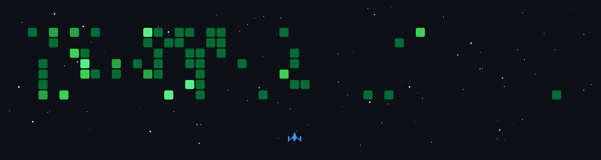

<div align="center">


<a href="https://git.io/typing-svg">
  
</a>

<br/><br/>

[](https://chayan.live)
[](https://www.linkedin.com/in/chayan-das-a863aa25a/)
[](https://github.com/Nikk-123)

<sub>My portfolio is a working Windows desktop. Double-click the icons at <a href="https://chayan.live">chayan.live</a> 🖥️</sub>

</div>

<br/>

## 👋 About me

<table>
<tr>
<td width="62%" valign="top">

```ts
const chayan = {
  education:      "B.Tech, Computer Science @ Adamas University",
  specialisation: ["Computer Vision", "Full Stack Development"],
  askMeAbout:     ["Python", "Computer Vision", "Backend logic"],
  currently:      "Building ML-powered apps that ship",
  openTo:         ["Collaborations", "Internships", "Freelance"],
};
```

</td>
<td width="38%" align="center" valign="middle">


</td>
</tr>
</table>

<br/>

## 🛠️ Tech stack

<div align="center">

<table>
<tr>
<td align="center" width="170"><b>Languages &<br/>frameworks</b></td>
<td>
<picture>
  <source media="(prefers-color-scheme: light)" srcset="https://skillicons.dev/icons?i=python,cpp,c,js,dart,php,flask,nodejs,flutter,html,css&theme=light&perline=11" />
  
</picture>
</td>
</tr>
<tr>
<td align="center"><b>ML / CV</b></td>
<td>
<picture>
  <source media="(prefers-color-scheme: light)" srcset="https://skillicons.dev/icons?i=tensorflow,pytorch,opencv&theme=light&perline=11" />
  
</picture>
</td>
</tr>
<tr>
<td align="center"><b>Databases &<br/>cloud</b></td>
<td>
<picture>
  <source media="(prefers-color-scheme: light)" srcset="https://skillicons.dev/icons?i=mongodb,mysql,docker,aws,gcp,azure&theme=light&perline=11" />
  
</picture>
</td>
</tr>
<tr>
<td align="center"><b>Tools</b></td>
<td>
<picture>
  <source media="(prefers-color-scheme: light)" srcset="https://skillicons.dev/icons?i=git,postman,vscode,jira&theme=light&perline=11" />
  
</picture>
</td>
</tr>
</table>

</div>

<br/>

## 🌟 Featured projects

<table>
<tr>
<td width="50%" valign="top">

### 🔍 Low-Light Object Detection
Real-time object detection pipeline built for dark and low-visibility scenes.

`Python` · `OpenCV` · `PyTorch` · `YOLOv8`

[](https://github.com/Nikk-123)

</td>
<td width="50%" valign="top">

### 💧 Quantum Watermarking
Quantum-inspired digital image watermarking using CCNOT gates, simulated in Qiskit.

`Python` · `Qiskit` · `NumPy` · `scikit-image`

[](https://github.com/Nikk-123)

</td>
</tr>
<tr>
<td width="50%" valign="top">

### 🎵 Groovo
Desktop music streaming app with its own standalone authentication service.

`Flask` · `pywebview` · `Python` · `Render`

[](https://github.com/Nikk-123)

</td>
<td width="50%" valign="top">

### ♟️ N Queens Visualizer
Step-by-step visualiser comparing different algorithms for the N Queens problem.

`HTML` · `CSS` · `JavaScript`

[](https://github.com/Nikk-123)

</td>
</tr>
</table>

<div align="center">
<sub>More on the <a href="https://chayan.live">portfolio</a> 🚀 always building, always shipping</sub>
</div>

<br/>

## 🎮 Contribution graph: Space Shooter edition

<div align="center">

</div>

<br/>

## 💭 Developer wisdom

<div align="center">

</div>

<br/>

<div align="center">

### 🤝 Open to collaborate

*Always excited to work on projects at the intersection of ML and real-world applications.*

[](https://www.linkedin.com/in/chayan-das-a863aa25a/)


</div>
